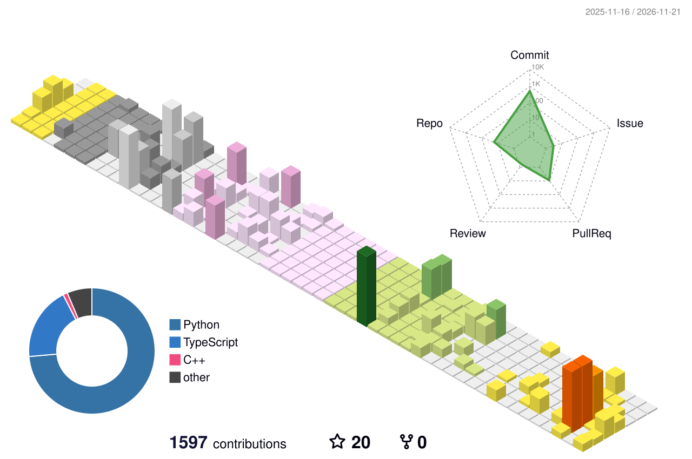

 

CS student. I work on computer vision, and on getting models to run on small, cheap hardware.

## Now

- **Research intern in a university deep learning lab.** Training and benchmarking YOLOv8 through YOLOv11 on 1M+ thermal frames.
- **2026 IEEE Computer Society Career Catalyst Scholar.** Built [Seeker](https://github.com/darskkaa/seeker) with my team and demoed it at Qualcomm HQ.

## Projects

<table>
<tr>
<td width="55%" valign="top">

<h3><a href="https://github.com/darskkaa/seeker">Seeker</a></h3>
A fully offline robot dog that finds a target named by voice and walks to it. YOLO11n on ONNX Runtime runs at 0.35 s/frame on the Arduino UNO Q's Qualcomm chip.
</td>
<td width="45%" valign="top">
<h3><a href="https://github.com/darskkaa/internship-alert-bot">Internship Alert Bot</a></h3>
Polls 1,400+ job boards every 10 minutes and posts new internships to Discord. 7,800+ runs at 99.8% success.
  
<h3>Project SCALPEL</h3>
SSH honeypot on a Raspberry Pi that replays 9,994 recorded command outputs and falls back to an LLM when unsure. 1st place at the eMerge AI Hackathon (USF and U.S. Army DEVCOM ARL).
</td>
</tr>
</table>

## Open source

- **[scikit-image](https://github.com/scikit-image/scikit-image/pulls?q=is%3Apr+author%3Adarskkaa+is%3Amerged)**: 2 merged PRs ([#8424](https://github.com/scikit-image/scikit-image/pull/8424), [#8426](https://github.com/scikit-image/scikit-image/pull/8426)) that let its Cython kernels accept read-only NumPy arrays. Closed 3 issues.
- **[comma.ai video compression challenge](https://github.com/commaai/comma_video_compression_challenge)**: took #1 on the leaderboard with a score of 0.126 ([PR #151](https://github.com/commaai/comma_video_compression_challenge/pull/151)). Currently #3 of 77.

## Stack

<picture>
  <source media="(prefers-color-scheme: dark)" srcset="https://skillicons.dev/icons?i=python,c,cpp,go,java,rust,ts,bash,pytorch,docker,linux,aws,raspberrypi,arduino,git&perline=15&theme=dark">
  
</picture>

## Activity

<picture>
  <source media="(prefers-color-scheme: dark)" srcset="profile-3d-contrib/profile-night-rainbow.svg">
  
</picture>

